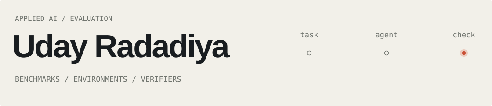

<picture>
  <source media="(max-width: 600px) and (prefers-reduced-motion: no-preference)" srcset="./assets/profile-header-mobile.gif?v=2">
  <source media="(prefers-reduced-motion: no-preference)" srcset="./assets/profile-header.gif?v=2">
  <source media="(max-width: 600px)" srcset="./assets/profile-header-mobile.svg">
  
</picture>

**I engineer rigorous evaluations and verifiable rewards for AI agents.**

Currently with **Snorkel AI** (contract, multiple projects) and **Abundant** (YC-backed).

**[Portfolio ↗](https://udayyyyy.github.io/)** · [LinkedIn](https://www.linkedin.com/in/uday-radadiya/) · [Say hello](mailto:udayradadiya65@gmail.com)
